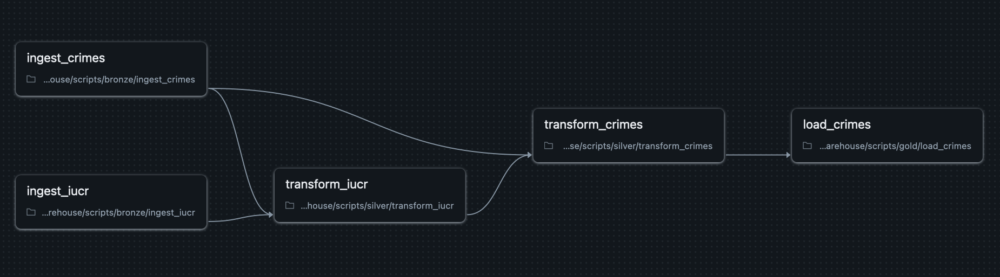

# Chicago Crime Data Warehouse and Dashboard

This project was built to practice real-world data engineering skills by designing and implementing a Data Warehouse using tools that are actively in demand in the industry — Databricks, Unity Catalog and Power BI

## 📚 Project Overview

This project starts from business questions about crime in Chicago, not from the tools. Using **Chicago Crime Data** and **Boundaries - Community Areas** sourced via the **Socrata Open Data API (SODA)** on the Chicago Data Portal, the pipeline ingests and transforms the data into a Data Warehouse, which is then used to answer those business questions through a Power BI dashboard.

## 📂 Table of Contents

-  [`01_Business Context`](./docs/01_business_context.md)
-  [`02_Source Data Dictionary`](./docs/02_sources_data_dictionary.md)
-  [`03_Star Schema Design`](./docs/03_star_schema_design.md)

Documents on the data architecture, design decisions and component breakdown are planned but not written yet.

## 🕹️ Technology Used

| Tool | Role in this project |
| --- | --- |
| Azure Key Vault | Securely stores the Socrata App Token; Databricks retrieves it via a Secret Scope |
| Azure Data Lake Storage Gen2 | Stores data for every layer (Bronze/Silver/Gold) following the Medallion Architecture |
| Databricks (Notebook + Workflows) | Processes data with PySpark on serverless compute and orchestrates the daily Bronze -> Silver -> Gold run as one Job (schedule, task order, retries, failure email) |
| Unity Catalog | Governance - groups, catalog/schema/table permissions, table comments and automatic lineage |
| Entra ID / Managed Identity | Authentication between Databricks and ADLS (through the Access Connector) without using connection strings or keys |
| GitHub Actions | *(planned)* Deploys notebook code to Databricks (lightweight CI/CD) |
| Power BI | *(planned)* Dashboard that answers business questions using data from the Gold layer |

## ▶️ How to implement the project

### 🧱 1. Setup Environment
1. create **Resource Group** - `rg-chicago-crime-dw` as the container for all project resources.
2. create **Storage Account with ADLS Gen2** - `chicagocrimeadlsgen2` with Hierarchical namespace enabled, Shared key access disabled, Hot access tier, TLS 1.2 minimum
3. create **Containers** inside `chicagocrimeadlsgen2` - `bronze`, `silver`, `gold` and `catalog root`
4. create **Key Vault** - `kv-chicago-crime` with Vault access policy; create an access policy by provide permission get, list, set to secret permissions; stored the Socrata App Token as secret `socrata-app-token`
5. store **Socrata App Token** - registered at [`data.cityofchicago.org`](https://data.cityofchicago.org), generated a free App Token (dataset: ijzp-q8t2), stored it in Key Vault
6. create **Databricks Workspace** - `dbw-chicago-crime-dw`, Premium tier, Hybrid/Classic workspace type, SCC = No
7. create **Entra ID Admin User** - `dbadmin` as a cloud-native organizational account with Global Administrator role, required because the Azure sign-up identity (a personal/Gmail-derived account) cannot authenticate to the Databricks Account Console
8. verify **Unity Catalog Metastore** - whether a metastore already existed in the target region (Databricks auto-provisions one per region on workspace creation); assigned it to `dbw-chicago-crime-dw`
9. create **Access Connector** - `ac-chicago-crime-dw` and granted it **Storage Blob Data Contributor** on `chicagocrimeadlsgen2`
10. create **Storage Credential** - `cred-chicago-crime-dw` in Unity Catalog, referencing the Access Connector's resource ID; granted **CREATE EXTERNAL LOCATION** privilege to the working account
11. create **External Location** - `ext-loc-bronze`, `ext-loc-silver`, `ext-loc-gold` and `ext-loc-catalogroot` each mapped to its respective container via `abfss://<container>@chicagocrimeadlsgen2.dfs.core.windows.net/`
12. create **Catalog & Schema** - create catalog `chicago_crime` use `ext-loc-catalogroot` for **storage location**; created schemas `bronze`, `silver` and `gold`, each with an explicit storage location pointing to its matching External Location

### 🏅 2. Medallion Architecture

#### 🥉 Bronze  

Bronze keeps the source data exactly as it arrived: every column is stored as text and nothing is cleaned. Run the notebooks is [`scripts/bronze/`](./scripts/bronze)

| Notebook | Source | Writes | Load pattern | In the daily Job? |
| --- | --- | --- | --- | --- |
| `ingest_boundaries` | Boundaries - Community Areas (`igwz-8jzy`) | `bronze.community_area_boundaries` | full load, overwrite | No, run by hand when the boundaries change (see [5. Orchestration](#5-orchestration---databricks-workflows)) |
| `ingest_iucr` | CPD IUCR Codes (`c7ck-438e`) | `bronze.iucr_codes` | full load, overwrite | Yes |
| `ingest_crimes` | Crimes - 2001 to Present (`ijzp-q8t2`) | `bronze.crimes` (append-only) and `bronze.load_control` | incremental: rows with `updated_on` after the saved watermark, read in 30-day chunks | Yes |

`ingest_crimes` starts from `updated_on > 2015-01-01` on the first run. It filters on `updated_on`, not on the incident date, so incidents from before 2015 are included when their record was updated after that date.

#### 🥈 Silver Layer 

Silver turns the text of Bronze into typed, checked data. A row that breaks a rule is **never fixed by guessing**: the whole row goes to a quarantine table with its original Bronze text and the name of every rule it broke. The notebooks are in [`scripts/silver/`](./scripts/silver). The first time, run them in this order (the daily Job later runs only the last two):

| Order | Notebook | Reads | Writes | In the daily Job? |
| --- | --- | --- | --- | --- |
| 1 | `transform_boundaries` | `bronze.community_area_boundaries` | `silver.community_area_boundaries` | No, run by hand when the boundaries change |
| 2 | `transform_iucr` | `bronze.iucr_codes` | `silver.ref_iucr` | Yes |
| 3 | `transform_crimes` | `bronze.crimes` + the two reference tables above | `silver.crimes`, `silver.crimes_quarantine`, `silver.load_control` | Yes |

What `transform_crimes` does, in short:

1. reads only the Bronze rows loaded since the last watermark (`_ingested_at`, saved in `silver.load_control`)
2. runs 11 groups of data checks (schema, text, types, key and duplicates, required columns, ranges, formats, reference values, relations between columns, `date`/`block` decomposition, row counts)
3. writes the rows that broke a rule to `silver.crimes_quarantine`, and stops the run when more than `MAX_QUARANTINE_PCT` % of the batch is quarantined
4. keeps the newest version of every `id` and writes the rest to `silver.crimes` with `MERGE INTO`
5. moves the watermark forward only after both writes succeeded, so a failed run can simply be run again

#### 🥇 Gold Layer

Gold turns the checked rows of Silver into the star schema of [`03_Star Schema Design`](./docs/03_star_schema_design.md): one fact table, seven dimensions and a copy of the community-area boundaries. One notebook loads all of it, [`scripts/gold/load_crimes`](./scripts/gold/load_crimes.ipynb), and in the daily Job it runs right after `transform_crimes` (the first time, run it after all three Silver notebooks). It uses the Gold part of [`scripts/helpers`](./scripts/helpers.ipynb).

| Table | Built from | Load pattern |
| --- | --- | --- |
| `gold.dim_date`, `gold.dim_time` | generated: every day from 2001-01-01 to 2040-12-31, and the 24 hours of a day | rebuilt in full (overwrite) |
| `gold.ref_community_area_boundaries` | `silver.community_area_boundaries` | rebuilt in full (overwrite) |
| `gold.dim_crime_type`, `gold.dim_location_description`, `gold.dim_block`, `gold.dim_location` | `silver.crimes` (`dim_location` also uses `gold.ref_community_area_boundaries` for the community-area name) | append-only: only combinations that are not in the table yet are added, each with the next surrogate key |
| `gold.dim_arrest_status` | `silver.crimes` | SCD Type 2 with `MERGE INTO`: a changed arrest or domestic flag closes the current row and adds a new one |
| `gold.fact_crime` | `silver.crimes` and the dimensions above | `MERGE INTO` on `id`: a row is replaced only when its `updated_on` is not older |
| `gold.load_control` | - | one row per table (`crimes`) holding the watermark |

### 🎻 3. Orchestration - Databricks Workflows

One Databricks Job, `chicago-crime-daily`, runs the pipeline once a day. It has five tasks. Each task is one notebook, runs on serverless compute and uses the notebook from the Git folder in the workspace.

### 👨🏻‍⚖️ 4. Governance - Unity Catalog

Permissions are given to groups, not to people, so a person can join or leave without changing any permission. The SQL is in [`scripts/governance/grants`](./scripts/governance/grants.ipynb).

| Group | Catalog `chicago_crime` | `bronze` | `silver` | `gold` |
| --- | --- | --- | --- | --- |
| `data_engineers` | `USE CATALOG` | all privileges | all privileges | all privileges |
| `analysts` | `USE CATALOG` | none | none | `USE SCHEMA` + `SELECT` |

## ⚠️ Known limitations 

- **Scope starts in 2015:** the first run reads rows whose `updated_on` is after 2015-01-01, so older incidents appear only if their record was updated later.
- **Time to arrest** is reliable only for changes detected after the pipeline started, because earlier changes cannot be seen from the source API.

