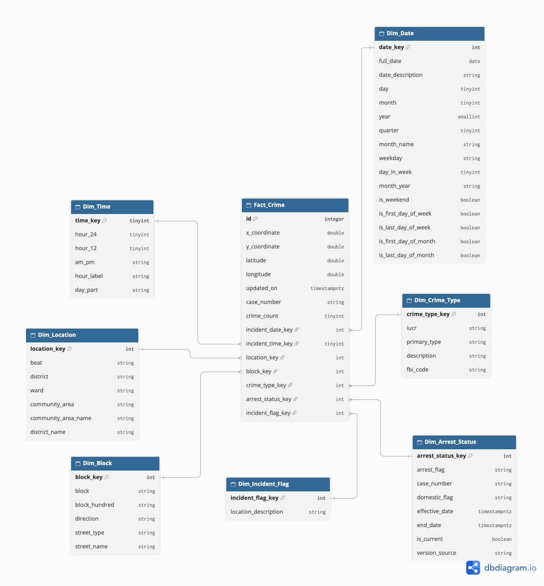

# ⭐️ Star Schema Design (Gold Layer) - Kimball's 4-Step Dimensional Design Process

This document designs the Gold Layer Star Schema following Ralph Kimball's 4-step process)

## Step 1 - Select the Business Process

**Business process chosen**: Incident Reporting & Investigation Tracking

**Important**: Boundaries - Community Areas is not a new business process - it's just a reference/geographic dimension that adds a spatial dimension to the existing business process

## Step 2 - Declare the Grain

**Grain statement**: One row in `fact_crime` represents one reported offense recorded by CPD (Chicago Police Department), identified by the natural key `id`. A single investigative case (`case_number`) may bundle multiple offense records

**Fact Table Type**: A transaction fact table maintained via MERGE/UPSERT because existing cases can be updated retroactively (`updated_on`)

## Step 3 - Identify the Dimensions

|Dimension|Business question it answers|
|---|---|
|`dim_date`|Time patterns (weekday/weekend, monthly, quarterly trend)|
|`dim_time`|Hour-of-day crime patterns, patrol shift timing|
|`dim_location`|Spatial patterns at the beat/district/ward/community-area level|
|`dim_block`|Street-level location detail (direction, street type/name)|
|`dim_crime_type`|Which crime types occur most often, and where|
|`dim_arrest_status`|How arrest rate changes over time, delayed arrests|
|`dim_incident_flag`|Domestic-related incidents, incident location setting|

### 3.1 `dim_date`

|Column|Type|Source|Notes|
|---|---|---|---|
|`date_key`|int|derived from `full_date`|Surrogate key, format `YYYYMMDD` (year first so the integer sorts chronologically), generated from `full_date` (**USE AS A FK FOR JOIN ONLY!!**)|
|`full_date`|date|`date` from `Chicago Crime 2001 - Present`|`SELECT explode(sequence(DATE'2001-01-01', DATE'2040-12-31', INTERVAL 1 DAY)) AS full_date`|
|`date_description`|string|derived from `full_date`|Human-readable full date, e.g. "Monday, January 1, 2024"|
|`day`|tinyint|derived from `full_date`||
|`month`|tinyint|derived from `full_date`||
|`month_name`|string|mapped from `month`||
|`year`|smallint|derived from `full_date`|`YEAR(full_date)` — must be `smallint`, not `tinyint` (range -128..127 cannot hold a calendar year)|
|`month_year`|string|derived from `month` + `year`|e.g. "2024-01", convenience column for monthly trend charts|
|`quarter`|tinyint|derived from `month`|`CEIL(month/3)`|
|`weekday`|string|derived from `full_date`|e.g. "Monday"..."Sunday"|
|`day_in_week`|tinyint|derived from `full_date`|1-7, numeric companion to `weekday` so a chart axis sorts in calendar order instead of alphabetical order|
|`is_weekend`|boolean|derived from `weekday`|`true` if Saturday or Sunday|
|`is_first_day_of_week`|boolean|derived from `full_date`||
|`is_last_day_of_week`|boolean|derived from `full_date`||
|`is_first_day_of_month`|boolean|derived from `full_date`||
|`is_last_day_of_month`|boolean|derived from `full_date`||

### 3.2 `dim_time`

|Column|Type|Source|Notes|
|---|---|---|---|
|`time_key`|tinyint|derived|Surrogate key = the hour value itself (0-23), a smart key in the same spirit as `date_key` (**USE AS A FK FOR JOIN ONLY!!**)|
|`hour_24`|tinyint|derived|Hour in 24-hour format (0-23), kept separate from `time_key` for readability|
|`hour_12`|tinyint|derived|Hour in 12-hour format (1-12)|
|`am_pm`|string|derived|"AM" / "PM"|
|`hour_label`|string|derived|Display-ready label, e.g. "14:00"|
|`day_part`|string|derived|"Night (00-05)", "Morning (06-11)", "Afternoon (12-17)", "Evening (18-23)" — a general 4-way split, **not** an official CPD patrol watch schedule (no authoritative source for CPD's actual shift-hour boundaries was found; adjust these buckets if one turns up later)|

### 3.3 `dim_location`

|Column|Type|Source|Notes|
|---|---|---|---|
|`location_key`|int|derived|Surrogate key|
|`beat`|string|`beat` from `Chicago Crime 2001 - Present`||
|`district`|string|`district` from `Chicago Crime 2001 - Present`|`beat` is a strict subset of `district` (CPD encodes the district number as a numeric prefix inside the beat code), so one beat always belongs to exactly one district|
|`district_name`|string|CPD's published district list|e.g. "1st District" = "Central" — looked up from CPD's own district reference, not present anywhere in the crime dataset itself|
|`ward`|string|`ward` from `Chicago Crime 2001 - Present`||
|`community_area`|string|`community_area` from `Chicago Crime 2001 - Present`||
|`community_area_name`|string|`community` from `Boundaries - Community Areas`|Not present anywhere in the crime data itself — added via a lookup join on `community_area`|

> `latitude`/`longitude`/`x_coordinate`/`y_coordinate` are not here because raw coordinates are close to unique per incident — putting
> them in a dimension would make `dim_location` balloon to nearly one row per fact row, defeating the point of having a dimension at all.
> They live in `fact_crime` instead, as Non-additive Facts.

### 3.4 `dim_block`

|Column|Type|Source|Notes|
|---|---|---|---|
|`block_key`|int|derived|Surrogate key|
|`block`|string|`block` from `Chicago Crime 2001 - Present`|Raw anonymized block-level address, e.g. "025XX W ADDISON ST"|
|`block_hundred`|string|parsed from `block`||
|`direction`|string|parsed from `block`|e.g. "West", "North"|
|`street_name`|string|parsed from `block`||
|`street_type`|string|parsed from `block`|e.g. "Avenue", "Street"|

> **Why a new dimension instead of a Degenerate Dimension, or merging into `dim_location`**: `block` on its own (one high-cardinality
> identifier, no descriptive attributes) would be a textbook Degenerate Dimension. Once decomposed into real sub-attributes
> (`direction`, `street_type`, `street_name`) it stops being "just an identifier" and becomes a true dimension. Merging those
> sub-attributes into `dim_location` was rejected for the same reason `dim_location_type` was originally split out: they're
> orthogonal to `district`/`ward`/`beat`/`community_area` (a street segment can sit in any geographic area and vice versa), so
> merging would balloon `dim_location`'s row count for no analytical benefit.
> asks for street-level detail, but the fact table already carries `block_key`

### 3.5 `dim_crime_type`

|Column|Type|Source|Notes|
|---|---|---|---|
|`crime_type_key`|int|derived|Surrogate key|
|`iucr`|string|`iucr` from `Chicago Crime 2001 - Present`|Illinois's own 434-code classification; `primary_type`/`description` are both derived from this|
|`primary_type`|string|`primary_type` from `Chicago Crime 2001 - Present`||
|`description`|string|`description` from `Chicago Crime 2001 - Present`||
|`fbi_code`|string|`fbi_code` from `Chicago Crime 2001 - Present`|FBI/NIBRS-aligned classification, coarser than `iucr` (likely many-`iucr`-to-one-`fbi_code`); kept as a bare code with no description column — no official city/CPD reference table mapping `fbi_code` to a description could be found, so adding one would mean relying on an unverifiable external source|

### 3.6 `dim_arrest_status`

|Column|Type|Source|Notes|
|---|---|---|---|
|`arrest_status_key`|int|derived|Surrogate key|
|`case_number`|string|`case_number` from `Chicago Crime 2001 - Present`|Kept here (not just on the fact table) so the full status-change history for a case can be queried directly by `case_number`|
|`arrest_flag`|string|`arrest` from `Chicago Crime 2001 - Present`|Text values: "Arrest Made", "No Arrest" — per Kimball's "Flags and Indicators as Textual Dimension Attributes" technique, not a raw boolean/0-1|
|`domestic_flag`|string|`domestic` from `Chicago Crime 2001 - Present`|Text values: "Domestic", "No Domestic"|
|`effective_date`|timestamp|derived from `updated_on`|Set to the `updated_on` value at the load cycle when this version of the row was created|
|`end_date`|timestamp|derived|Set to the next version's `effective_date` when a newer version is inserted; `null` while the row is still current|
|`is_current`|boolean|derived|Maintained by the SCD 2 MERGE logic; exactly one row per `case_number` has `is_current = true` at any time|
|`version_source`|string|derived|`BACKFILL` for records from initial load, `DETECTED_CHANGE` for an actual detected change|

> **Why SCD Type 2**: arrest status can change retroactively, so history must be preserved to calculate "average time-to-arrest",
> which is a direct business question.
>
> **Why `arrest_flag` itself didn't move to `dim_incident_flag` too**: unlike `domestic_flag`/`location_description`, `arrest_flag`
> genuinely needs change history (SCD Type 2). Junk dimensions are flat/static by nature — they aren't built to track history —
> so arrest status has to stay in its own dedicated SCD2 dimension.

### 3.7 `dim_location_description`

|Column|Type|Source|Notes|
|---|---|---|---|
|`location_description_key`|int|derived|Surrogate key|
|`location_description`|string|`location_description` from `Chicago Crime 2001 - Present`||

## Step 4 - Identify the Facts

**Fact Table**: `fact_crime`

|Column|Type|Fact type|Source|Notes|
|---|---|---|---|---|
|`id`|int|-|`id` from `Chicago Crime 2001 - Present`|Primary Key; kept as-is from source — no separate surrogate key needed for the fact table|
|`case_number`|string|Degenerate Dimension|`case_number` from `Chicago Crime 2001 - Present`|Also appears in `dim_arrest_status`, but for a different purpose — this one is a stable, grouping/tracing identifier at the fact's own grain, independent of the mutable `arrest_status_key` FK (which gets rewritten every time the arrest status changes)|
|`incident_date_key`|int (FK)|-|Derived|Named by business role, not just "date_key" (Role-Playing Dimension naming) → `dim_date.date_key`|
|`incident_time_key`|tinyint (FK)|-|Derived|→ `dim_time.time_key`|
|`location_key`|int (FK)|-|Derived|→ `dim_location.location_key`|
|`block_key`|int (FK)|-|Derived|→ `dim_block.block_key`|
|`crime_type_key`|int (FK)|-|Derived|→ `dim_crime_type.crime_type_key`|
|`arrest_status_key`|int (FK)|-|Derived|→ `dim_arrest_status.arrest_status_key`; always points to the row where `is_current=true` for that case. **1st**: close the existing current row — set `end_date` to the new `effective_date` and `is_current=false`. **2nd**: insert the new current row with `is_current=true`. **3rd**: update `fact_crime.arrest_status_key` for that `case_number` to the newly inserted row's key|
|`location_description_key`|int (FK)|-|Derived|→ `dim_location_description.dim_location_description_key`|
|`x_coordinate`|double|Non-additive Fact|`x_coordinate` from `Chicago Crime 2001 - Present`|State Plane coordinate; `0` is a known geocoding-failure sentinel value|
|`y_coordinate`|double|Non-additive Fact|`y_coordinate` from `Chicago Crime 2001 - Present`|Same as above|
|`latitude`|double|Non-additive Fact|`latitude` from `Chicago Crime 2001 - Present`|Too continuous/non-aggregatable to be a Degenerate Dimension or a dimension attribute — can never be meaningfully summed|
|`longitude`|double|Non-additive Fact|`longitude` from `Chicago Crime 2001 - Present`|Same as above|
|`crime_count`|tinyint|Additive Fact|Derived|Constant literal 1|
|`updated_on`|timestamp|-|`updated_on` from source|Used as the watermark for incremental load; not linked to `dim_date` — it's ETL/technical plumbing, not a business date|

### ‼️ Special Table: `ref_community_area_boundaries` (from `Boundaries - Community Areas` only)

|Column|Type|Source|Notes|
|---|---|---|---|
|`community_area_code`|int|`area_numbe`|Canonical join key; the duplicate `area_num_1` field is dropped in Silver|
|`community_area_name`|string|`community`||
|`boundary_geometry`|string|`the_geom`|Kept as a raw string, not parsed into a native geometry type|
|`shape_area_sqft`|double|`shape_area`||
|`shape_perimeter_ft`|double|`shape_len`||

> This table exists purely to avoid that waste; it plays no role in the normal analytical join path (crime counts,
> arrest rates, time trends never touch it) — its only consumer is the BI/map-rendering layer.
